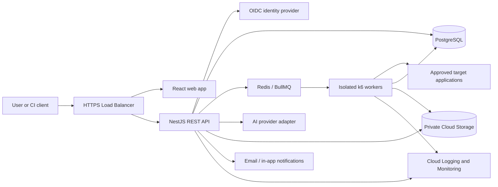
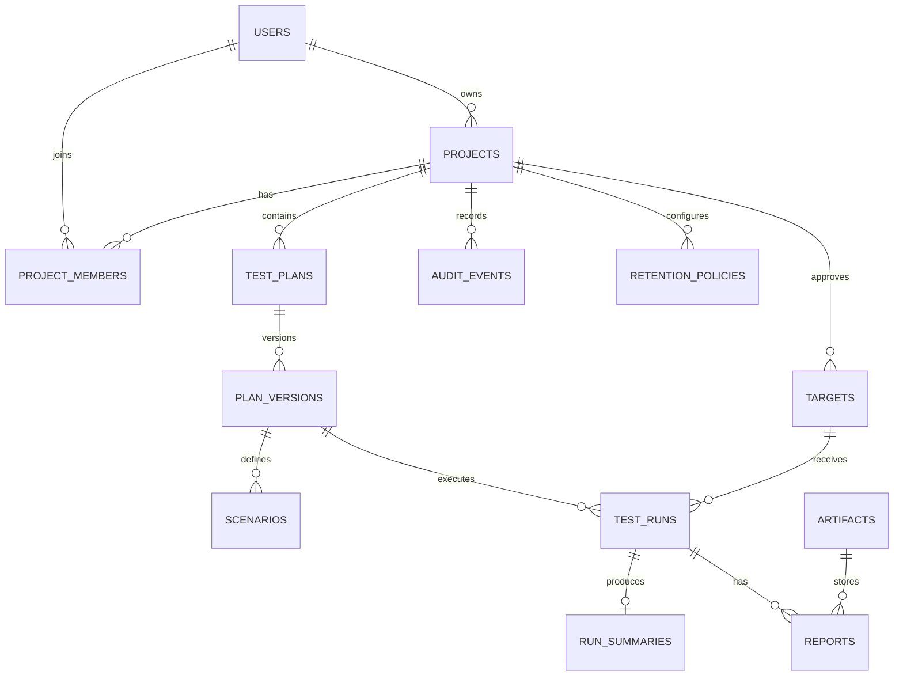
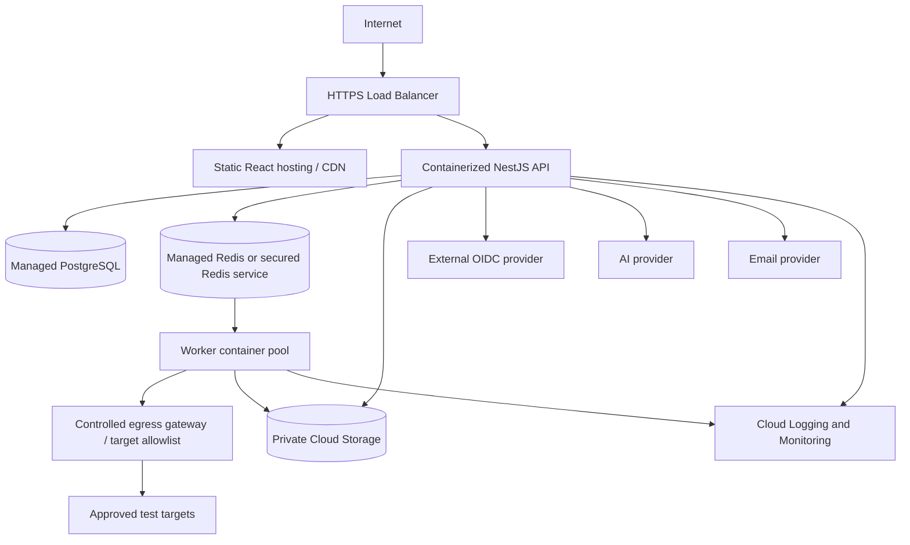

# AI Performance Testing Agent — Architecture

## 1. Project Overview

An AI-assisted performance testing platform that helps teams plan performance tests, generate and manage k6 scripts, run authorized tests, analyze results, and create reports. The MVP provides a browser application and versioned REST API for human users and CI/CD automation.

## 2. Business Use Case

Performance engineers and developers use the platform to turn application workflows or API specifications into test plans, execute controlled load tests, understand performance outcomes, and share reports. The service aims to shorten test cycles and reduce repetitive specialist effort while keeping humans in control of target authorization and run approval.

## 3. Problem Statement

Current performance testing requires substantial manual effort across workflow analysis, workload design, script creation, execution, monitoring, analysis, and reporting. This slows releases, raises costs, and produces inconsistent results.

## 4. Proposed Solution

A web application and API that coordinate AI-assisted planning and script generation, safe background k6 runs, results analysis, and report production. AI output is proposed content that users can review; test execution requires explicit approval and enforced target/workload controls.

## 5. Project Objectives

- Reduce manual effort in the performance testing lifecycle.
- Make test plans, scripts, runs, and reports reproducible and traceable.
- Enforce authorization, target allowlists, and bounded workloads.
- Provide useful results and basic downloadable reports.
- Integrate with CI/CD through a stable REST API.

## 6. Functional Requirements

- Authenticate users through Google Identity using OpenID Connect; domain, MFA, and user-lifecycle configuration remain to be confirmed.
- Create projects and register approved application targets.
- Accept requirements and API specifications for test planning.
- Use one selected AI provider (pending) to assist with scenario and k6 script generation and result interpretation.
- Let users review/edit scripts and test parameters.
- Require authorization confirmation and explicit run approval.
- Execute queued k6 tests with configured concurrency, duration, and request limits.
- Track queued, running, completed, failed, cancelling, and cancelled run states.
- Store run summaries and detailed result artifacts; produce downloadable scripts and basic reports.
- Compare runs and present SLA threshold status where a user has configured thresholds.
- Provide audit events and operational dashboards/alerts.
- Notify users in the application and/or by email before planned deletion so they can back up data.
- Allow users to initiate deletion of their data.

## 7. Non-Functional Requirements

- Initial capacity: up to five concurrent test runs.
- No formal uptime target has been set.
- Isolate load-test workers from API services and apply resource/network limits.
- Use TLS in transit, managed encryption at rest, least-privilege service identities, and private artifact storage.
- Keep job execution asynchronous and resilient to worker restarts.
- Maintain auditability of run approvals, execution, and data deletion.
- Retention: 30-day period was selected; deletion timing/automation and notice lead time need confirmation (see Pending Decisions).

## 8. User Roles and Permissions

MVP uses one shared authenticated user role. All authenticated users can create plans, register targets, generate scripts, start runs, and view artifacts in the applicable workspace. Because there are no role distinctions, workspace ownership/access boundaries must be explicit. Do not expose one user's private data to unrelated users. Future organization and fine-grained roles are an enhancement.

## 9. MVP Scope

Included: React web app, versioned REST API, project/target and plan management, AI-assisted plan/script generation, k6 scripts, bounded background execution, result summaries, basic downloadable reports, audit/monitoring, OIDC authentication, and GitHub Actions integration support through API credentials.

Out of scope for MVP: JMeter/LoadRunner/Gatling, multi-cloud deployment, complex approval chains, formal 24/7 SLA, broad enterprise role hierarchy, and unrestricted arbitrary target execution.

## 10. Technology Stack

| Layer | Selected recommendation | Notes |
|---|---|---|
| Web | React + TypeScript | Dashboard for plans, runs, and reports. |
| API | NestJS + TypeScript | Modular monolith with versioned REST endpoints. |
| Database | PostgreSQL | Relational metadata, ownership, plans, runs, summaries, audit. |
| Queue | Redis + BullMQ | Background job dispatch and retries; Redis is an operational dependency. |
| Load engine | k6 | Initial script format and execution engine. |
| Object storage | Google Cloud Storage | Private bucket for scripts, raw results, and reports. |
| Cloud | Google Cloud | Containerized API and isolated worker workloads. |
| CI/CD | GitHub Actions | Separate development, staging, production deployments. |
| Identity | Google Identity / Google Cloud Identity | OIDC provider selected; configure client, audience, MFA, and user lifecycle. |
| AI | One provider behind an adapter | Provider remains to be selected. |
| Observability | Google Cloud Logging and Monitoring | Structured logs, dashboards, metrics, alerts. |

## 11. Technology Selection Rationale

TypeScript across frontend and backend supports shared validation/types and simplifies team context switching. NestJS gives a modular structure for the API and orchestration logic, with more conventions than a minimal Node framework. PostgreSQL suits related business records and transactional updates. BullMQ supports asynchronous work, but Redis adds operations and must be configured for persistence/availability appropriate to the deployment. Google Cloud Storage is suitable for larger artifacts and keeps binaries out of relational rows. Workers are isolated because load generation can consume substantial CPU/network and must not impair the control plane. AI and identity vendors are intentionally abstracted pending selection.

## 12. System Architecture

The system is a modular monolith for the control plane, paired with independently scalable worker containers. Modules: identity/access, projects/targets, planning, script generation, run orchestration, result analysis, reports, artifacts, retention/notifications, audit/operations. Workers execute k6 and report status/results. PostgreSQL is the source of truth for workflow state; the queue is delivery machinery, not the sole record of a run.

## 13. Architecture Diagram



## 14. Frontend Architecture

React single-page application organized by feature: authentication, projects/targets, plans, script review, run monitoring, results/reports, and settings. Call the REST API through a typed client. Keep tokens out of local storage where possible; prefer a backend-for-frontend secure session pattern if the selected identity integration supports it. Render AI-generated content as untrusted text, never executable HTML. Show workload limits, target, authorization confirmation, and run approval together before launch.

## 15. Backend Architecture

NestJS modules should have controller, application/service, persistence adapter, DTO/validation, and domain model boundaries. Controllers handle HTTP only. Services enforce business and safety rules. Queue producers create jobs only after database transaction records the approved run. Workers are a separate process/container using shared domain contracts; worker callbacks/status updates must be idempotent. Use transactional outbox or a recoverable enqueue pattern to avoid a committed run that is never queued. Keep AI/provider and notification integrations behind interfaces.

## 16. Database Architecture

PostgreSQL stores structured records and status. Use UUID primary keys, UTC timestamps, foreign keys, unique constraints, and soft deletion only where justified by audit requirements. Store large files in object storage; database records hold object key, checksum, size, media type, and lifecycle timestamps. Do not store secrets or raw credentials in plans or scripts. Use schema migrations and backward-compatible deploy sequencing.

## 17. Database Schema

Suggested initial tables:

- `users(id, oidc_issuer, oidc_subject, email, display_name, created_at, disabled_at)`; unique `(oidc_issuer, oidc_subject)`.
- `projects(id, name, owner_user_id, created_at, updated_at, deleted_at)`.
- `project_members(project_id, user_id, created_at)`; supports shared-role membership without introducing role distinctions.
- `targets(id, project_id, name, base_url, approved_domains, authorization_confirmed_by, authorization_confirmed_at, created_at, disabled_at)`.
- `test_plans(id, project_id, created_by, name, source_type, source_ref, status, created_at, updated_at)`.
- `plan_versions(id, plan_id, version, workload_json, requirements_text, created_by, created_at)`; unique `(plan_id, version)`.
- `scenarios(id, plan_version_id, name, k6_options_json, created_at)`.
- `artifacts(id, project_id, plan_version_id nullable, run_id nullable, kind, object_key, sha256, size_bytes, content_type, created_at, delete_after nullable, deleted_at nullable)`.
- `test_runs(id, project_id, plan_version_id, target_id, requested_by, status, authorization_confirmed_at, approved_at, queued_at, started_at, completed_at, failure_code, created_at)`.
- `run_summaries(id, run_id, metrics_json, sla_status, created_at)`; one summary per completed run, with commonly queried values optionally normalized later.
- `reports(id, run_id, artifact_id, format, created_at)`.
- `audit_events(id, project_id, actor_user_id nullable, action, resource_type, resource_id, details_json, created_at)`; avoid secrets and sensitive payloads.
- `retention_policies(id, project_id, retention_days, notice_days nullable, deletion_mode, updated_at)`.
- `retention_notifications(id, project_id, scheduled_deletion_at, notified_at, channel, status, created_at)`.
- `api_tokens(id, user_id, token_hash, name, scopes, expires_at, last_used_at, revoked_at, created_at)` for CI automation if approved; store only token hashes.

Indexes: project ownership/membership lookups; `(project_id, created_at)` on plans/runs/audit; `(status, queued_at)` on runs; `(delete_after)` on artifacts; unique version numbers; target hostname/domain lookup. Validate URLs against scheme, DNS/IP ranges, allowlists, and redirect behavior at both registration and execution. Avoid accepting private/metadata IP destinations unless explicitly configured for a controlled private test environment.

### ER diagram



## 18. Entity Relationship Diagram

The ER diagram in Section 17 is the initial relationship model. A plan is versioned so a run remains reproducible even after later plan edits. Artifacts are referenced by immutable object keys and checksums.

## 19. API Design

Base path `/api/v1`; JSON; OIDC-authenticated user endpoints. Use `Authorization: Bearer <access-token>` for API clients where applicable. Responses use stable error shape `{ "error": { "code", "message", "requestId", "details" } }`. Validate inputs with DTO schemas; return 400 for validation, 401/403 for auth, 404 for unavailable resources, 409 for state conflicts, 429 for rate/queue limits, 202 for accepted background work. Paginate collections with opaque cursors. Apply per-user and per-project rate limits. API tokens for CI should be scoped, hashed at rest, revocable, and issued only after provider/credential design is approved.

| Method | Endpoint | Purpose |
|---|---|---|
| POST | `/projects` | Create project. |
| GET | `/projects` | List accessible projects. |
| POST | `/projects/{projectId}/targets` | Register approved target. |
| GET | `/projects/{projectId}/targets` | List project targets. |
| POST | `/projects/{projectId}/plans` | Create plan. |
| POST | `/plans/{planId}/generate` | Request AI-assisted scenario/script generation. |
| GET | `/plans/{planId}` | Read current plan and versions. |
| POST | `/plans/{planId}/runs` | Approve and enqueue a run. |
| GET | `/runs/{runId}` | Read status and result summary. |
| POST | `/runs/{runId}/cancel` | Request cancellation. |
| GET | `/runs/{runId}/reports` | List run reports. |
| POST | `/artifacts/{artifactId}/download-link` | Issue short-lived signed download URL after access check. |
| GET | `/projects/{projectId}/retention` | Read configured retention/notice state. |
| POST | `/projects/{projectId}/deletion-requests` | Request project/data deletion. |

## 20. API Request and Response Examples

Create a target:

```http
POST /api/v1/projects/8dc.../targets
Authorization: Bearer <access-token>
Content-Type: application/json
```

```json
{
  "name": "Staging API",
  "baseUrl": "https://staging.example.test",
  "approvedDomains": ["staging.example.test"],
  "authorizationConfirmed": true
}
```

```json
{
  "id": "3a52f4a2-5bf1-4c69-91a4-f3c9c3442f00",
  "name": "Staging API",
  "status": "active",
  "createdAt": "2026-10-24T10:15:00Z"
}
```

Start a run:

```http
POST /api/v1/plans/2b1.../runs
Authorization: Bearer <access-token>
Idempotency-Key: 7e1...
Content-Type: application/json
```

```json
{
  "targetId": "3a52f4a2-5bf1-4c69-91a4-f3c9c3442f00",
  "planVersion": 3,
  "workload": { "virtualUsers": 20, "durationSeconds": 300 },
  "authorizationConfirmed": true,
  "approved": true
}
```

```http
202 Accepted
```

```json
{
  "runId": "81e06199-fefc-49ae-aad4-0c73d65355e9",
  "status": "queued",
  "createdAt": "2026-10-24T10:20:00Z",
  "statusUrl": "/api/v1/runs/81e06199-fefc-49ae-aad4-0c73d65355e9"
}
```

A run response includes status, timestamps, summary metrics and report IDs when available. Do not expose raw internal logs or signed object URLs in list responses. Errors should include a request ID and actionable validation details without disclosing secrets.

## 21. Authentication and Authorization

Use OIDC Authorization Code flow with PKCE for browser login. Validate issuer, audience, signature, expiry, nonce, and state. Google Identity is the selected provider; configure the OAuth client and confirm domain, MFA, and user lifecycle. API clients should use scoped, expiring/revocable tokens rather than user passwords; token lifecycle and provider support need selection. Enforce project membership and ownership on every object lookup. Shared role means equal capabilities within a project, not global access to every tenant's data.

## 22. Security Architecture

- Require explicit target ownership/authorization confirmation and approved-domain allowlists.
- Enforce virtual-user, duration, rate, concurrent-run, and resource ceilings at API and worker layers.
- Re-resolve and validate target DNS at execution; block loopback, link-local, cloud metadata, and private ranges by default; prevent redirects from escaping the approved target policy.
- Workers run in isolated containers with CPU/memory limits, restricted egress, non-root identity, read-only base filesystem where feasible, and short-lived access to only required artifacts.
- Encrypt in transit and at rest; use Secret Manager for provider credentials and database/Redis credentials.
- Sanitize uploaded specifications; limit size/type; avoid rendering active content.
- Treat AI output as untrusted; validate scripts, prohibit unexpected network destinations, and require human review before execution.
- Keep credentials out of prompts unless explicitly required and approved; redact logs and use provider data controls.
- Use CSRF protections for cookie sessions, security headers, dependency scanning, rate limiting, and OWASP-aligned input handling.
- Audit run approvals, launches, cancellations, downloads where practical, and deletions.

## 23. External Integrations

- **AI provider:** Adapter interface for planning, script assistance, and analysis. Provider selection pending. Define data minimization, retention, training-use policy, quotas, timeout/retry behavior, and prompt-injection handling before production use.
- **Identity provider:** Google Identity selected. Confirm domain, MFA, user lifecycle, and logout requirements.
- **k6:** Pin a supported runtime/container image; validate generated scripts and execution options.
- **Notifications:** In-app notification is internal; email provider pending. Use an outbox/retry design and record delivery state.
- **GitHub Actions:** CI can invoke API with scoped credentials once token issuance is finalized.

## 24. File Storage and Processing

Use private Cloud Storage buckets separated by environment. Store scripts, raw k6 output, and generated reports. Use opaque object names, checksums, content-type allowlists, encryption, lifecycle controls, and short-lived signed URLs after authorization checks. Files should be malware/content scanned where applicable. Artifact deletion must remove object and metadata consistently, with retries and audit records. User-requested exports/backups should be available before scheduled deletion; export format and scope are future implementation details.

## 25. Error Handling

Use typed internal errors mapped to stable API error codes. Distinguish validation errors, policy rejections, provider failures, queue saturation, worker failures, and target application errors. Retry transient provider/queue/storage failures with bounded exponential backoff and idempotency. Do not automatically retry a load test unless safe policy explicitly permits it, because rerunning creates real load. Mark terminal failures with diagnostic reference IDs; retain redacted logs.

## 26. Logging and Monitoring

Emit structured JSON logs with request/run/correlation IDs, user/project IDs where appropriate, and redacted fields. Metrics: API latency/error rates, queue depth/age, active workers, run duration/outcome, resource consumption, notification delivery, storage and AI-provider failures. Dashboards and alerts cover API health, stuck jobs, worker capacity, queue saturation, failed runs, and unusual resource use. Audit records are separate from diagnostic logs and have an explicit retention policy.

## 27. Testing Strategy

- Unit tests: validation, workload policy, authorization, state transitions, retention calculations.
- Integration tests: PostgreSQL repositories, queue/outbox flow, storage adapter, identity token validation with test keys.
- API tests: success and rejection cases, access isolation, pagination, idempotency.
- Worker tests: script validation, limits, cancellation, retry and result upload behavior; use a local controlled test target.
- UI tests: key plan-to-run and result review flows with Playwright.
- Security tests: SSRF/DNS rebinding/redirect policy, access control, input/upload handling, dependency scanning.
- CI checks: lint, typecheck, automated tests, build, container scanning; deploy to staging before production.
- Never run load tests against systems without explicit authorization; use isolated fixtures for test validation.

## 28. CI/CD Architecture

GitHub Actions builds and checks pull requests, publishes immutable container images, deploys to development/staging, runs migrations using controlled jobs, and promotes approved artifacts to production. Use workload identity federation to Google Cloud where supported instead of long-lived cloud keys. Protect production environment with required reviewers and rollback to prior image. Database changes use expand/migrate/contract sequencing. Store CI secrets in GitHub environment secrets or cloud Secret Manager with least privilege.

## 29. Cloud Deployment Architecture



Use separate cloud projects or equivalent isolation for development, staging, and production. Deploy API and workers as separate container workloads; workers scale only within configured run limits. Exact Google Cloud products (for example Cloud Run versus GKE) should be selected based on required worker duration, networking, and k6 resource needs during deployment design; do not assume arbitrary long-running tests fit request-oriented runtimes.

## 30. Environment Configuration

Maintain separate development, staging, and production configurations. Configuration includes database/queue endpoints, bucket names, OIDC issuer/client IDs, AI endpoint/model, notification settings, workload ceilings, approved target policy, and retention settings. Secrets belong in Secret Manager or CI environment secrets, never in source control or generated scripts. Use managed identities and rotation. Staging should use synthetic data and an isolated target.

## 31. Project Folder Structure

```text
ai-performance-agent/
  apps/
    web/                         # React application
    api/                         # NestJS HTTP control plane
    worker/                      # Queue consumer and k6 execution
  packages/
    contracts/                   # Shared API/job types and schemas
    config/                      # Shared lint/build configuration
  infra/
    terraform/                   # Cloud infrastructure modules
  docs/
    Architecture.md
    runbooks/
  database/
    migrations/
    seeds/
  tests/
    e2e/
  .github/workflows/
  package.json
  README.md
```

Within `apps/api/src`, organize by feature modules (`identity`, `projects`, `targets`, `plans`, `generation`, `runs`, `artifacts`, `reports`, `retention`, `notifications`, `audit`). Each module contains controllers, services, DTOs, persistence adapters, and tests as appropriate. Keep worker execution code isolated from HTTP controllers.

## 32. Implementation Phases

### Phase 1 — Foundation and threat model
Objective: establish repository, conventions, and safety boundaries. Tasks: workspace setup, CI checks, cloud environment plan, target threat model, workload policy. Dependencies: none. Deliverables: repo skeleton, ADRs, threat model. Acceptance: CI runs; target and resource policies reviewed. Testing: lint/typecheck and policy unit tests.

### Phase 2 — Identity, projects, targets, and persistence
Objective: secure tenant-scoped foundation. Tasks: OIDC integration, project membership, PostgreSQL schema/migrations, target registration and validation, audit events. Dependencies: Google OAuth client and identity policy configuration. Deliverables: authenticated APIs and project/target UI. Acceptance: users cannot access unrelated project data; unsafe targets rejected. Testing: API/access control and URL policy tests.

### Phase 3 — Planning and script generation
Objective: create reviewable plans and k6 scripts. Tasks: plan/version model, AI adapter, input specification handling, script generation, editing/review UI. Dependencies: AI provider decision and data policy. Deliverables: saved plan versions and downloadable scripts. Acceptance: generated output validated and requires user review before run. Testing: provider contract mocks, injection/input tests, script validation tests.

### Phase 4 — Run orchestration and k6 workers
Objective: execute bounded asynchronous tests. Tasks: queue/outbox, worker containers, k6 runtime, cancellation/state transitions, allowlist revalidation, resource ceilings. Dependencies: cloud networking and worker runtime choice. Deliverables: queued run lifecycle and status UI. Acceptance: no run bypasses authorization/limits; retries do not duplicate unsafe execution. Testing: local controlled target, queue recovery, cancellation, limit tests.

### Phase 5 — Results, reports, retention, notifications
Objective: persist results and provide reports with deletion notice controls. Tasks: summary analysis, report generation, private object storage, artifact download, user delete, retention scheduler, in-app/email notifications. Dependencies: retention schedule/notice and email provider decisions. Deliverables: run summaries, downloadable reports, notification records. Acceptance: users receive notice before any configured deletion; deletion removes data and artifacts according to policy. Testing: lifecycle, notification retry, export/deletion consistency.

### Phase 6 — Operations and release readiness
Objective: deploy and operate safely. Tasks: dashboards/alerts, security scanning, staging deployment, backup/restore, runbooks, load/capacity evaluation. Dependencies: cloud product selection and operational ownership. Deliverables: production pipeline and runbooks. Acceptance: restore is demonstrated; alerts cover stuck jobs and capacity; production rollout can roll back. Testing: staging end-to-end and controlled capacity tests.

## 33. Dependencies

- Decisions: Google Identity domain/MFA/user-lifecycle configuration; AI provider and data-use terms; email provider; deletion schedule and notice lead time; Google Cloud worker runtime/networking design; API token issuance model.
- External: Google Cloud project/billing and service accounts; GitHub repository and environments; approved test target environments; provider credentials.
- Product: final report formats, SLA thresholds, export/backup behavior, organization/project sharing policy.

## 34. Risks and Mitigations

| Risk | Mitigation |
|---|---|
| Unauthorized or overly aggressive load test | Target allowlists, authorization confirmation, explicit approval, hard workload ceilings, egress restrictions, audit. |
| SSRF or target policy bypass | DNS/IP checks at registration and run time; block sensitive ranges; validate redirects and DNS changes. |
| Worker saturation affects control plane | Separate worker pool, quotas, concurrency cap, queue backpressure. |
| AI creates unsafe/incorrect scripts | Treat output as untrusted, static validation, review step, restricted network, bounded runtime. |
| Lost or duplicate jobs | Durable run state, idempotency, transactional outbox/reconciliation, idempotent worker updates. |
| Data exposure through artifacts or AI provider | Private buckets, access-checked signed links, minimize/redact prompts, provider data controls. |
| Ambiguous deletion expectation | Confirm schedule and lead time; do not enable irreversible automatic deletion until policy is approved. |
| Unchosen identity/AI/email vendors delay delivery | Finalize provider decisions during foundation/integration phase; maintain adapters. |
| Test traffic hits production unexpectedly | Clearly label target environment, separate allowlists, require confirmation and policy limits. |

## 35. Assumptions

- The initial users are authenticated performance engineers/developers, with one shared permission level.
- Projects provide data isolation even though role distinctions are not required.
- k6 is the first supported execution tool.
- Users review generated plans/scripts and approve each run.
- PostgreSQL stores structured data; object storage holds large artifacts.
- AI analysis is advisory and not a substitute for measured metrics.
- Up to five simultaneous runs is the initial target, subject to per-run resource limits.

## 36. Pending Decisions

1. Google Identity domain, MFA, user lifecycle, and logout requirements.
2. AI provider, model, data handling, prompt retention, and acceptable inputs.
3. Email provider and notification delivery configuration.
4. **Retention policy:** 30 days was requested, and users asked for email/in-app notification before deletion to allow backup. Confirm whether 30 days is the deletion point or merely a minimum retention period, whether deletion is automatic after notice, the notice lead time, and whether data is retained until the user confirms or takes no action. Until resolved, do not run an automatic deletion job.
5. API automation token issuance, scope, expiry, and revocation policy.
6. Google Cloud execution product (Cloud Run or GKE/other) based on maximum test duration and worker networking/resource requirements.
7. Exact target allowlist ownership and support for private network targets.
8. Report formats for MVP and backup/export mechanism before deletion.

## 37. Future Enhancements

Support additional load tools (JMeter, Gatling, LoadRunner); role-based organization administration and approval workflows; advanced trend baselines and anomaly analysis; richer dashboards and report formats; scheduled tests and CI/CD callbacks; configurable retention and export; additional cloud and private-network deployment modes.

## 38. Definition of Done

- Users authenticate through the selected OIDC provider and project data is isolated.
- Users can register a target, create/version a plan, review a generated k6 script, and approve a bounded run.
- Workers execute only approved, allowlisted targets under enforced limits and expose reliable status.
- Results and reports are stored privately, access-checked, and downloadable.
- Run actions and deletions are auditable; application and worker health are observable with alerts.
- CI runs automated checks and deploys through dev/staging/prod with rollback guidance.
- Retention behavior and advance notice are approved, implemented, and verified before any automated deletion is enabled.
- Documentation, operational runbooks, and backup/restore procedures are available.
